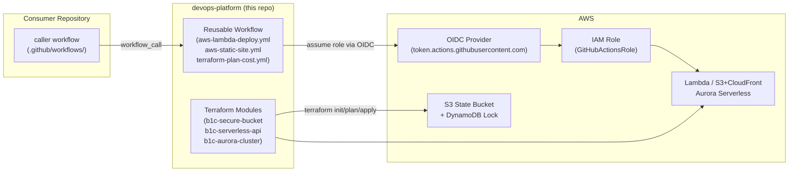

# devops-platform

Open-source AWS deployment engine: reusable GitHub Actions workflows and Terraform modules.

---

## Why this exists

Most teams reinvent the same deployment scaffolding for every project — OIDC wiring, S3 state buckets, Lambda packaging steps. This repository codifies a "Golden Path": a single, opinionated set of Terraform modules and reusable GitHub Actions workflows that any project can call instead of building from scratch. It fills the gap between "I have an AWS account" and "I have a working, cost-tracked, secure CI/CD pipeline," without locking consumers into a proprietary platform.

---

## Architecture

---

## What's inside

- **`modules/`** — Reusable Terraform building blocks:
  - `b1c-secure-bucket` — S3 with encryption, versioning, public-access block, and optional OIDC trust.
  - `b1c-serverless-api` — Lambda + HTTP API Gateway v2 + IAM execution role + CloudWatch log group.
  - `b1c-aurora-cluster` — Aurora Serverless v2 with KMS encryption, subnet/security group wiring, and IAM-auth-ready outputs.

- **`.github/workflows/`** — Reusable GitHub Actions workflows (called via `workflow_call`):
  - `aws-lambda-deploy.yml` — packages Python or Node source and deploys to Lambda via OIDC.
  - `aws-static-site.yml` — builds a frontend, syncs to S3, and invalidates CloudFront.
  - `terraform-plan-cost.yml` — runs `terraform plan` and posts an Infracost diff comment on pull requests.

- **`examples/`** — Runnable end-to-end demos showing how to wire the modules and caller workflows together.

---

## Quickstart for consumers

Full walkthrough is in [`docs/CONSUMER-QUICKSTART.md`](docs/CONSUMER-QUICKSTART.md) (being authored in parallel — see [Phase 3 of the roadmap](docs/PLAN.md)). The short version:

1. **Satisfy prerequisites** — see [`docs/PREREQUISITES.md`](docs/PREREQUISITES.md). You need an AWS account, an OIDC identity provider, a trusted IAM role, and a Terraform state backend.
2. **Call a reusable workflow** from your repository's `.github/workflows/` directory using `workflow_call` syntax, pointing at `B1Codes/devops-platform/.github/workflows/<workflow>.yml@main`.
3. **Reference a Terraform module** in your `main.tf` using the GitHub module source: `github.com/B1Codes/devops-platform//modules/<module-name>?ref=<tag>`.
4. **Open a pull request** — the `terraform-plan-cost.yml` workflow will comment a plan and cost diff automatically.

---

## Prerequisites

The short list:

- AWS account with billing enabled.
- OIDC identity provider for `token.actions.githubusercontent.com` configured in the target AWS account.
- IAM role trusted to your GitHub org/repo via the OIDC provider.
- S3 bucket and DynamoDB table for Terraform remote state.

See [`docs/PREREQUISITES.md`](docs/PREREQUISITES.md) for full setup instructions including copy-paste AWS CLI commands.

> **Note:** B1Codes' internal implementation of all of the above lives in the private `llc-infra-core` repository (B1Codes' internal Brain layer), which is not publicly available. Any functionally-equivalent setup works.

---

## License

MIT — see [`LICENSE`](LICENSE).
