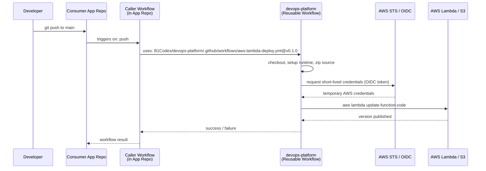
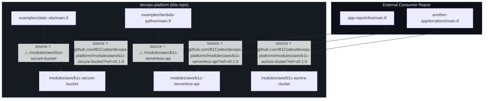

# Architecture

This document explains the two-layer design of the devops-platform engine and
how consumer applications connect to it.

---

## The Golden Path Methodology

The "Golden Path" is a paved road through infrastructure decisions: a set of
pre-approved, pre-tested patterns that any project can follow without needing
deep infrastructure expertise. Instead of every team designing its own Lambda
IAM roles, S3 encryption settings, and CloudFront OAC configuration, those
decisions are encoded once in this repo and consumed everywhere.

This approach has two concrete benefits:

1. **Consistency.** Security controls (public-access blocks, OIDC-only
   credentials, encrypted storage) are always present because they are
   embedded in the shared primitive, not in per-project configuration.

2. **Leverage.** When a module or workflow is improved — for example, adding
   a new CloudWatch metric alarm or upgrading to a newer Lambda runtime — all
   consumers pick up the change on their next `terraform apply`, without any
   per-repo changes.

---

## Two-Layer Design

### Layer 1 — Terraform Modules (`modules/`)

Modules are reusable building blocks that provision AWS resources. Each module
accepts variables, creates resources, and exposes outputs. Modules have no
`backend {}` block — state management is always the consumer's responsibility.

Current modules:

| Module | What it creates |
|---|---|
| `b1c-secure-bucket` | S3 bucket with encryption, versioning, public-access blocks |
| `b1c-serverless-api` | Lambda + API Gateway v2 + IAM execution role + CloudWatch log group |
| `b1c-aurora-cluster` | Aurora Serverless v2 cluster with KMS encryption and subnet group |

### Layer 2 — Reusable Workflows (`.github/workflows/`)

Reusable workflows (`workflow_call`) are the CI/CD primitive. A consumer repo
adds a 10-15 line caller workflow that passes inputs (function name, region,
source directory) and a single OIDC role secret. The reusable workflow handles
checkout, runtime setup, dependency installation, packaging, AWS auth, and
deployment.

This separation means infrastructure shape (Terraform) and deployment
mechanics (GitHub Actions) are independently evolvable.

---

## Diagram 1 — Deployment Flow

The following diagram shows how a push in a consumer application repository
triggers a deployment to AWS through this platform's reusable workflows.

---

## Diagram 2 — Terraform Module Layering

The following diagram shows how the Terraform modules in this repo are
consumed by the examples in this repo and by external application code.

---

## Conventions enforced by this design

- **No hardcoded account IDs or secrets.** Modules and workflows accept
  everything sensitive as variables or OIDC-derived credentials.
- **Pinned everywhere.** GitHub Actions `uses:` references are pinned to
  commit SHAs. Terraform provider versions use `~>` constraints.
- **No `backend {}` in modules.** State management is always the consumer's
  decision and lives outside the shared primitives.
- **OIDC only.** No workflow accepts a static `AWS_ACCESS_KEY_ID` or
  `AWS_SECRET_ACCESS_KEY`. All AWS authentication flows through short-lived
  OIDC tokens.
